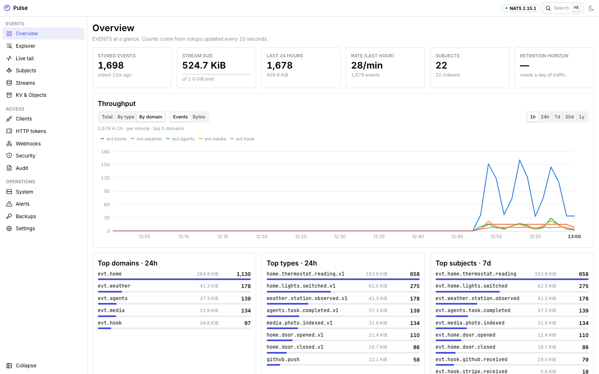
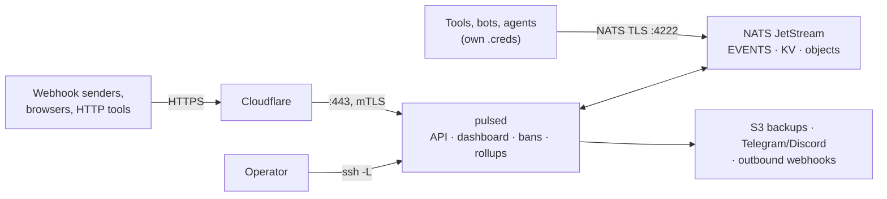
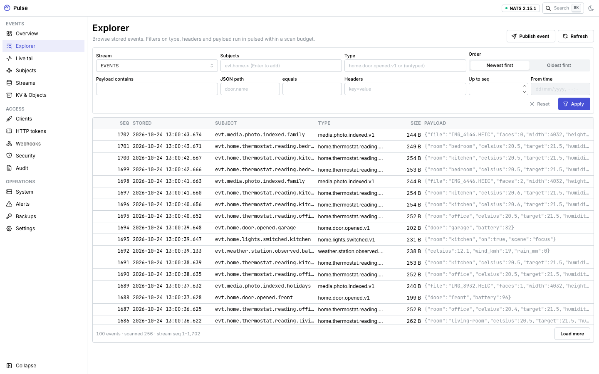
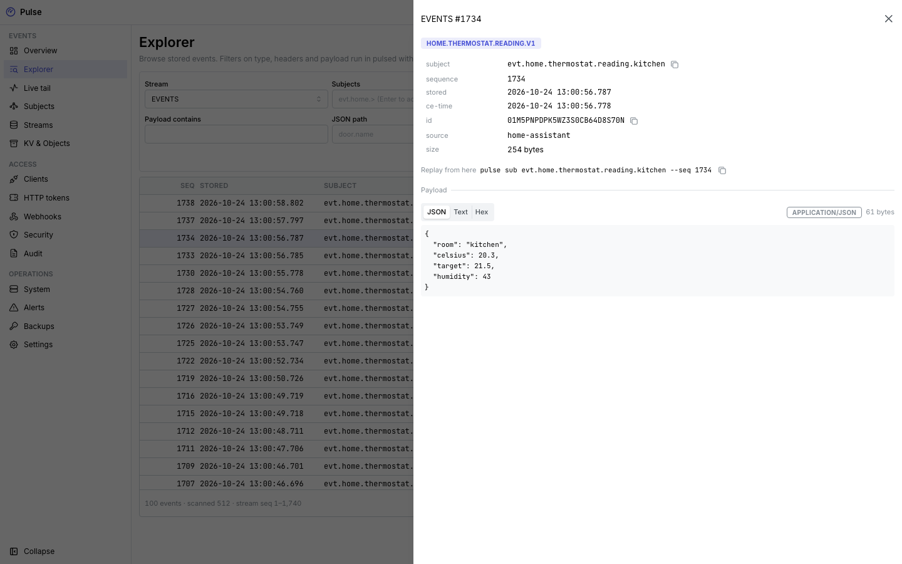
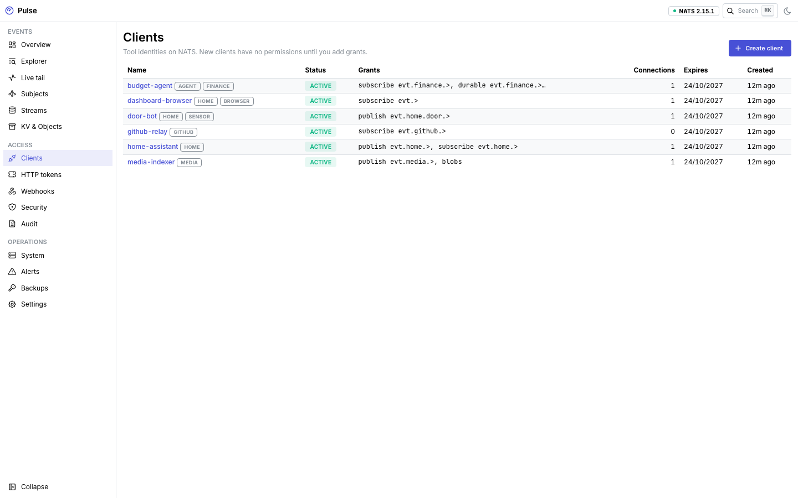
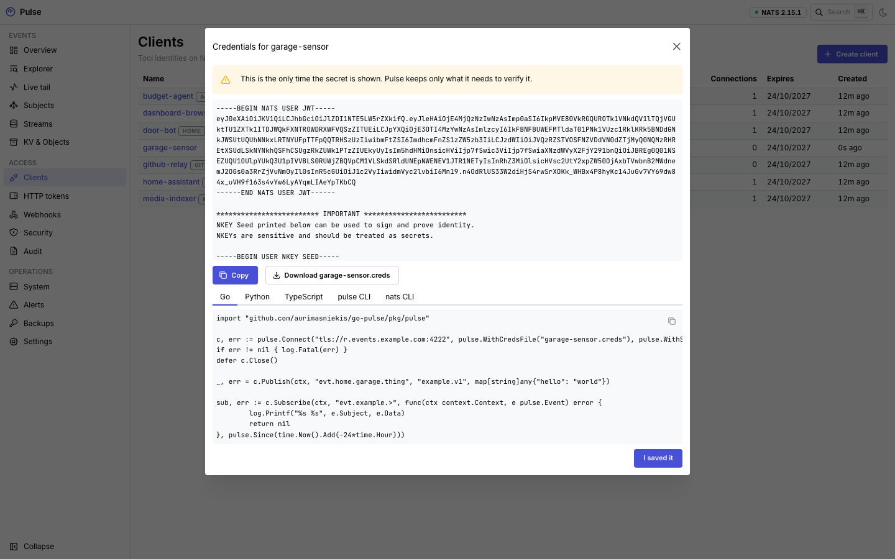
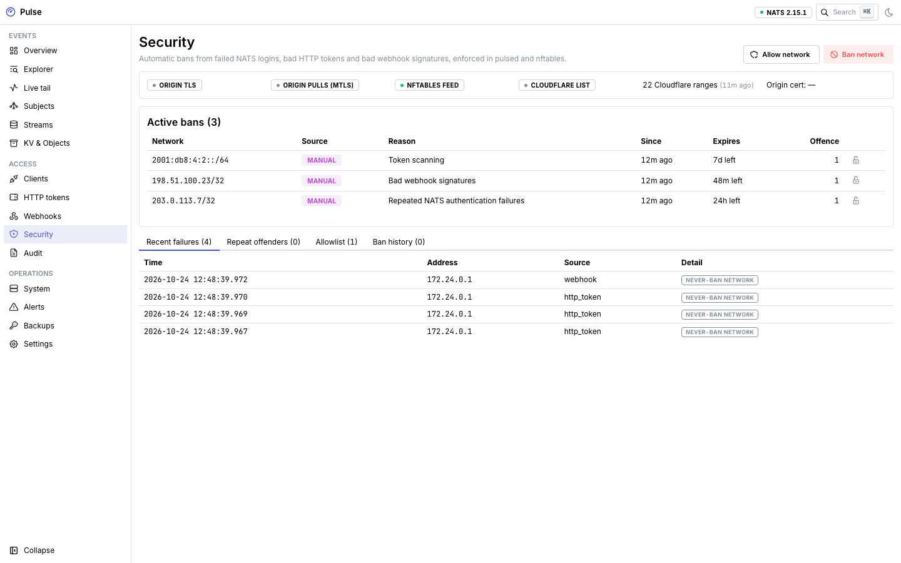
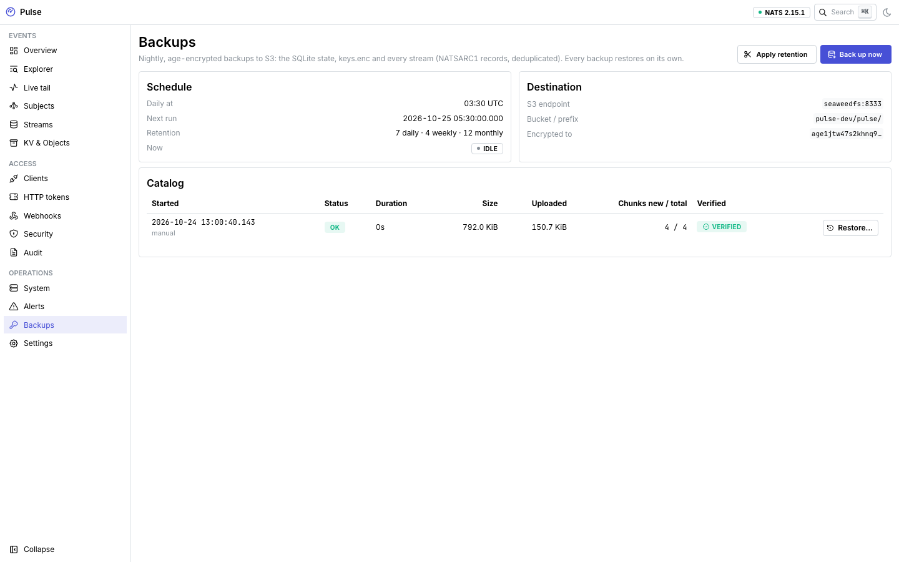

<p align="center">
  
</p>

<h1 align="center">Pulse</h1>

<p align="center">
  <strong>A personal, durable event bus on NATS JetStream.</strong><br>
  Every tool, bot and agent publishes and consumes through it, and any new tool can replay years of history from a
  timestamp.
</p>

<p align="center">
  <a href="https://aurimasniekis.github.io/go-pulse/">Documentation</a> ·
  <a href="https://aurimasniekis.github.io/go-pulse/guide/try-locally">Try it locally</a> ·
  <a href="https://aurimasniekis.github.io/go-pulse/clients/">Clients &amp; SDKs</a> ·
  <a href="https://aurimasniekis.github.io/go-pulse/security/">Security model</a>
</p>

> [!NOTE]
> **Pre-release.** No version is tagged yet; the first will be 0.1.0. Before 1.0, interfaces may change between minor
> versions ([docs/VERSIONING.md](docs/VERSIONING.md)). Known gaps: the sizing spike has not been run, the firewall and
> ban enforcement have not been verified on a real VPS, and nothing has had an external security review. Details are on
> the [security page](https://aurimasniekis.github.io/go-pulse/security/#release-status).

<picture>
  <source media="(prefers-color-scheme: dark)" srcset="site/public/screenshots/overview-dark.png">
  
</picture>

## Why

Home automation, GitHub, payment providers, scripts and AI agents all produce events. Usually each pair of tools gets
its own glue: a webhook here, a cron job there, a table nobody remembers. When a new tool needs last month's events,
they are gone.

Pulse is one place for all of it. Events go into a single JetStream stream that is kept for as long as the disk allows
(years at personal volumes). Each tool gets its own credentials that allow only the subjects it needs. A new tool
subscribes with `--since 2025-01-01` and gets everything from that day on, then live events, in order.

## How it works



1. `pulsed init` sets NATS up in JWT operator mode: its own operator, accounts and signing keys, sealed with a master
   key.
2. In the dashboard you create a **client** per tool with **grants** (`publish:evt.home.>`, `subscribe:evt.github.>`).
   Its `.creds` file is shown once. A new client can do nothing until you add grants.
3. Tools publish events like `evt.home.door.opened` with a small CloudEvents-style envelope, using the Go, Python or
   TypeScript SDK, the `pulse` CLI, plain `nats`, the HTTP API, or a signed webhook.
4. Anyone with a subscribe grant replays from a time or sequence and then follows live events. Durable consumers keep
   their position across restarts.

**Key features**

- **History you can replay.** One `EVENTS` stream on `evt.>`, kept until it reaches its size limit (60% of the disk in
  the reference deployment), with S2 compression and 2-minute de-duplication on the event ID.
- **Least-privilege clients.** Every client gets its own NATS user with permissions built from its grants and its own
  inbox. Rotation and revocation take effect within seconds and disconnect live sessions.
- **HTTP when NATS is not an option.** Tokens limited to subjects and source networks for publish, batch publish,
  request/reply, replay and an SSE live tail. Browsers can use NATS over WebSocket at `/ws`.
- **Webhooks in and out.** Inbound GitHub, Stripe, HMAC and shared-secret verifiers publish to a subject. Outbound
  hooks deliver events in order, signed and retried, with a delivery log and an SSRF guard.
- **A dashboard to see it all.** Event explorer with filters, live tail, subject tree, throughput and a disk forecast,
  streams and consumers, KV and object browser, clients, tokens, webhooks, security, alerts, backups and audit.
- **Edge security.** pulsed terminates TLS itself behind Cloudflare with Authenticated Origin Pulls. Raw NATS gets a
  Let's Encrypt certificate through DNS-01. Repeated authentication failures from NATS, HTTP or webhooks become bans,
  enforced in nftables, over HTTP and optionally in a Cloudflare IP list.
- **Backups that keep timestamps.** Nightly, age-encrypted, deduplicated backups to any S3-compatible store, kept on a
  7/4/12 schedule. Restores keep sequence numbers and stored times, so replay by time works the same afterwards.
- **Operable on a small box.** Designed for one VPS with 2 vCPU and 2 GB of RAM. One distroless image for `pulsed`
  plus the official NATS image, Prometheus metrics, alert rules with Telegram and Discord notifications, and an audit
  log of every change.

Pulse is **single-owner and single-node**: there is no clustering or high availability, and the dashboard has no
login yet. It binds to the host's loopback interface and you reach it through an SSH tunnel.

## Screenshots

| | |
|---|---|
| <br>**Event explorer** | <br>**One event, headers and payload** |
| <br>**Clients and their grants** | <br>**Credentials shown once, with snippets** |
| <br>**Bans and authentication failures** | <br>**Verified, encrypted backups** |

All screenshots come from a throwaway instance with fictional data (`make screenshots`).

## Quick start

### Try it on your machine

Needs Docker, Go (the version in `go.mod`), Node 24 and pnpm.

```sh
git clone https://github.com/aurimasniekis/go-pulse.git && cd go-pulse
make dev-up                     # init, NATS, pulsed, Alloy, SeaweedFS; dashboard on http://127.0.0.1:8080
go install github.com/aurimasniekis/go-pulse/cmd/pulse@latest

# The dev NATS listener serves a certificate from Pulse's internal CA.
curl -fsS http://127.0.0.1:8080/api/admin/v1/system/info | jq -r .connect.ca_cert > pulse-ca.pem
pulse clients create demo --grant 'publish:evt.demo.>' --grant 'subscribe:evt.demo.>'   # writes demo.creds once
pulse context add dev --url tls://127.0.0.1:4222 --creds ./demo.creds --ca ./pulse-ca.pem

pulse pub evt.demo.thing.created '{"hello":"world"}' -t demo.thing.created.v1
pulse sub 'evt.demo.>' --since 1h
```

The [local guide](https://aurimasniekis.github.io/go-pulse/guide/try-locally) explains each step.

### Deploy

The reference deployment is one Debian VPS behind Cloudflare, with
[`deploy/examples/compose.yaml`](deploy/examples/compose.yaml): `init`, `nats`, `pulsed`, `banagent` and `alloy`. Read
[Deploy on a VPS](https://aurimasniekis.github.io/go-pulse/guide/deploy) and the
[configuration reference](https://aurimasniekis.github.io/go-pulse/reference/configuration).

Release images will be published as `ghcr.io/aurimasniekis/pulsed` for linux/amd64 and linux/arm64, with an SBOM and
build provenance (`gh attestation verify oci://ghcr.io/aurimasniekis/pulsed:<version> --repo aurimasniekis/go-pulse`).
Pin them by digest. Until the first release, build the image yourself with `make image`.

## Clients

```go
c, _ := pulse.Connect("tls://r.events.example.com:4222", pulse.WithCredsFile("door-bot.creds"), pulse.WithSource("door-bot"))
c.Publish(ctx, "evt.home.door.opened", "home.door.opened.v1", map[string]any{"door": "front"})
c.Subscribe(ctx, "evt.home.>", pulse.Handle(func(ctx context.Context, e pulse.Event, d Door) error {
	return nil
}), pulse.Since(time.Now().Add(-24*time.Hour)))
```

```python
c = await connect("tls://r.events.example.com:4222", creds="door-bot.creds", source="door-bot")
async for e in c.subscribe("evt.home.>", since="24h"):
    print(e.sequence, e.subject, e.json())
```

```sh
curl -X POST https://events.example.com/api/v1/publish/evt.home.door.opened \
  -H "Authorization: Bearer $PULSE_TOKEN" -H 'Ce-Type: home.door.opened.v1' -d '{"door":"front"}'
```

| Client | Install |
|---|---|
| Go SDK | `go get github.com/aurimasniekis/go-pulse/pkg/pulse` |
| Python SDK (asyncio) | `pip install "git+https://github.com/aurimasniekis/go-pulse#subdirectory=sdk/python"` |
| TypeScript SDK (node and browser) | `pnpm add "github:aurimasniekis/go-pulse#path:/sdk/ts"` |
| `pulse` CLI | `go install github.com/aurimasniekis/go-pulse/cmd/pulse@latest` |

The three SDKs share one set of [conformance vectors](sdk/conformance/vectors.json), and an interop test checks that
Go, Python, node and a real browser read each other's events the same way. See
[Clients & SDKs](https://aurimasniekis.github.io/go-pulse/clients/).

## Documentation

The documentation website is **<https://aurimasniekis.github.io/go-pulse/>** (built from [`site/`](site/)).

| Topic | Where |
|---|---|
| Getting started, client and operator guides | [Website](https://aurimasniekis.github.io/go-pulse/) |
| Configuration contract (every `PULSE_*` variable) | [docs/operator/configuration.md](docs/operator/configuration.md) |
| Operator reference (deployment, keys, TLS, firewall, bans, backups, upgrades) | [docs/operator/](docs/operator/) |
| Subjects and the event envelope | [docs/ENVELOPE.md](docs/ENVELOPE.md) |
| HTTP APIs (OpenAPI 3.1) | [docs/API.md](docs/API.md), [api/public.openapi.json](api/public.openapi.json), [api/admin.openapi.json](api/admin.openapi.json) |
| Backup format and restores | [docs/BACKUPS.md](docs/BACKUPS.md) |
| Product contract, plan, decisions | [docs/GOAL.md](docs/GOAL.md), [docs/PLAN.md](docs/PLAN.md), [docs/DECISIONS.md](docs/DECISIONS.md) |
| Threat model, test strategy, sizing | [docs/THREAT_MODEL.md](docs/THREAT_MODEL.md), [docs/TEST_STRATEGY.md](docs/TEST_STRATEGY.md), [docs/SIZING.md](docs/SIZING.md) |
| Versioning and changelog | [docs/VERSIONING.md](docs/VERSIONING.md), [CHANGELOG.md](CHANGELOG.md) |

To work on the website: `make site-dev`.

## Security

Read the [threat model](docs/THREAT_MODEL.md) before deploying. It lists what Pulse defends against and the risks it
accepts. Report vulnerabilities privately; see [SECURITY.md](SECURITY.md).

## Contributing

See [CONTRIBUTING.md](CONTRIBUTING.md) for the development setup, the checks (`make check`, `make e2e`, the SDK
interop and restore drill tests) and the rules.

## License

[Apache License 2.0](LICENSE). See also [NOTICE](NOTICE).
