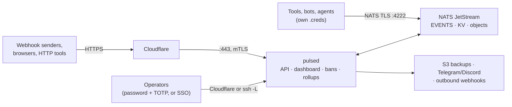
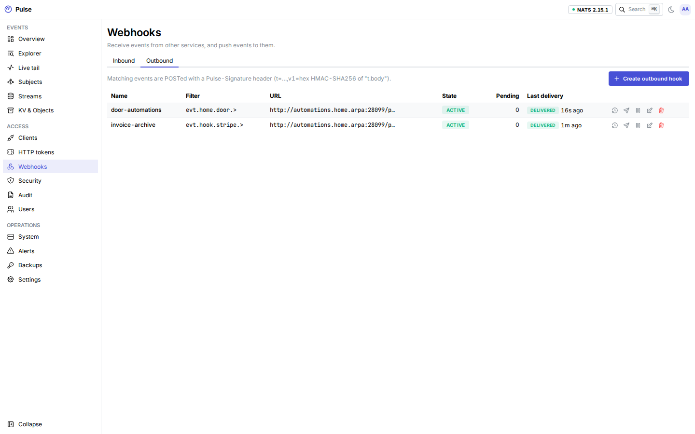
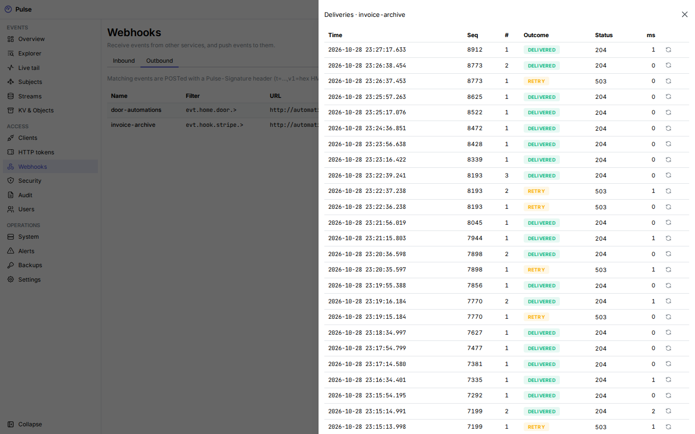
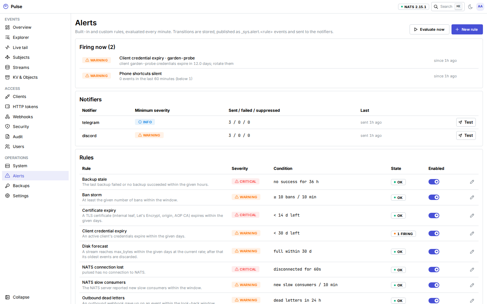
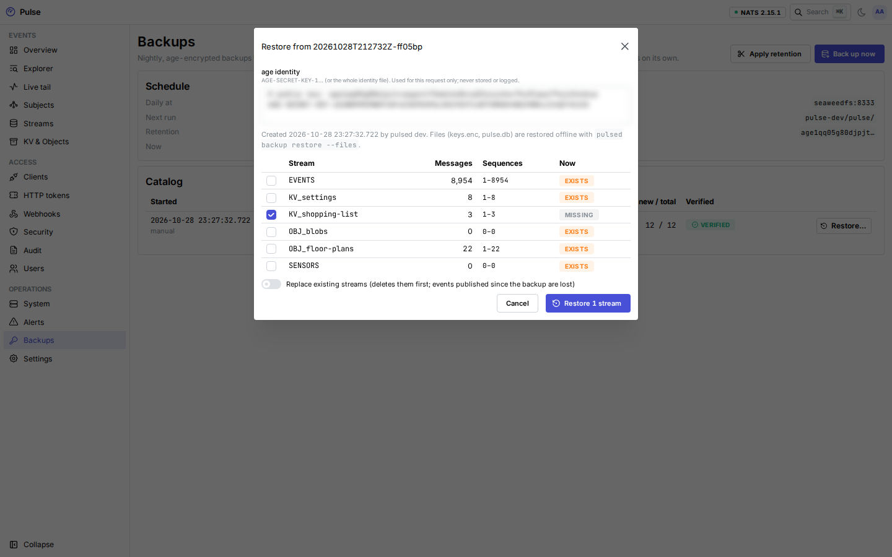
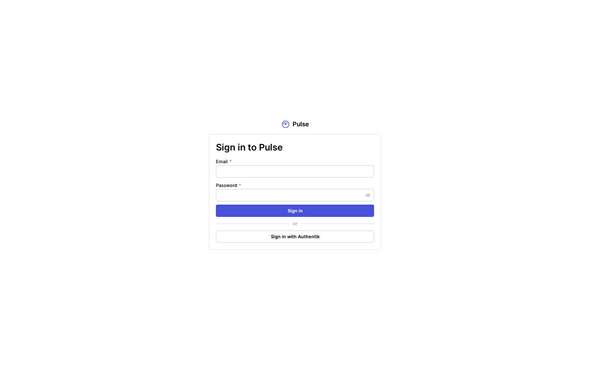
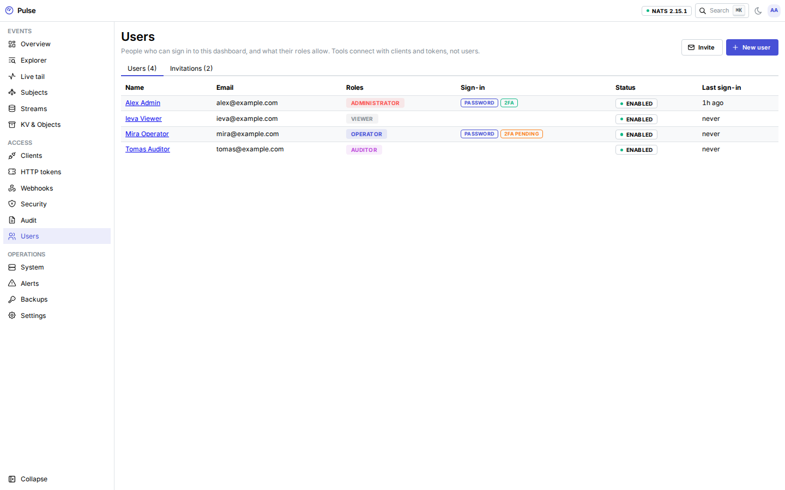

<p align="center">
  
</p>

<h1 align="center">Pulse</h1>

<p align="center">
  <strong>A personal, durable event bus on NATS JetStream.</strong><br>
  Every tool, bot and agent publishes and consumes through it, and any new tool can replay years of history from a
  timestamp.
</p>

<p align="center">
  <a href="https://aurimasniekis.github.io/go-pulse/">Documentation</a> ·
  <a href="https://aurimasniekis.github.io/go-pulse/guide/try-locally">Try it locally</a> ·
  <a href="https://aurimasniekis.github.io/go-pulse/clients/">Clients &amp; SDKs</a> ·
  <a href="https://aurimasniekis.github.io/go-pulse/security/">Security model</a>
</p>

<picture>
  <source media="(prefers-color-scheme: dark)" srcset="site/public/screenshots/overview-dark.png">
  
</picture>

## Why

Home automation, GitHub, payment providers, scripts and AI agents all produce events. Usually each pair of tools gets
its own glue: a webhook here, a cron job there, a table nobody remembers. When a new tool needs last month's events,
they are gone.

Pulse is one place for all of it. Events go into a single JetStream stream that is kept for as long as the disk allows
(years at personal volumes). Each tool gets its own credentials that allow only the subjects it needs. A new tool
subscribes with `--since 2025-01-01` and gets everything from that day on, then live events, in order.

## How it works



1. `pulsed init` sets NATS up in JWT operator mode: its own operator, accounts and signing keys, sealed with a master
   key.
2. In the dashboard you create a **client** per tool with **grants** (`publish:evt.home.>`, `subscribe:evt.github.>`).
   Its `.creds` file is shown once. A new client can do nothing until you add grants.
3. Tools publish events like `evt.home.door.opened` with a small CloudEvents-style envelope, using the Go, Python or
   TypeScript SDK, the `pulse` CLI, plain `nats`, the HTTP API, or a signed webhook.
4. Anyone with a subscribe grant replays from a time or sequence and then follows live events. Durable consumers keep
   their position across restarts.

**Key features**

- **History you can replay.** One `EVENTS` stream on `evt.>`, kept until it reaches its size limit (60% of the disk in
  the reference deployment), with S2 compression and 2-minute de-duplication on the event ID.
- **Least-privilege clients.** Every client gets its own NATS user with permissions built from its grants and its own
  inbox. Rotation and revocation take effect within seconds and disconnect live sessions.
- **HTTP when NATS is not an option.** Tokens limited to subjects and source networks for publish, batch publish,
  request/reply, replay and an SSE live tail. Browsers can use NATS over WebSocket at `/ws`.
- **Webhooks in and out.** Inbound GitHub, Stripe, HMAC and shared-secret verifiers publish to a subject. Outbound
  hooks deliver events in order, signed and retried, with a delivery log and an SSRF guard.
- **Users, roles and single sign-on.** Dashboard users sign in with a password and TOTP or through any OpenID Connect
  provider (PKCE, group → role mappings, just-in-time users, step-up), with administrator, operator, auditor and
  viewer roles, recovery codes, invitations, break-glass recovery and personal access tokens for the CLI and
  automation. The dashboard stays behind an SSH tunnel or, if you choose, is served behind Cloudflare (on its own
  hostname or the API hostname).
- **A dashboard to see it all.** Event explorer with filters, live tail, subject tree, throughput and a disk forecast,
  streams and consumers, KV and object browser, clients, tokens, webhooks, security, alerts, backups and audit.
- **Configuration as code.** A [Terraform provider](https://aurimasniekis.github.io/go-pulse/operators/terraform)
  manages clients, tokens, streams, buckets, webhooks, alert rules, users and single sign-on through the admin API,
  from the SSH tunnel or from CI with a token limited to the runner's networks.
- **Edge security.** pulsed terminates TLS itself behind Cloudflare with Authenticated Origin Pulls. Raw NATS gets a
  Let's Encrypt certificate through DNS-01. Repeated authentication failures from NATS, HTTP or webhooks become bans,
  enforced in nftables, over HTTP and optionally in a Cloudflare IP list.
- **Backups that keep timestamps.** Nightly, age-encrypted, deduplicated backups to any S3-compatible store, kept on a
  7/4/12 schedule. Restores keep sequence numbers and stored times, so replay by time works the same afterwards.
- **Operable on a small box.** Designed for one VPS with 2 vCPU and 2 GB of RAM. One distroless image for `pulsed`
  plus the official NATS image, Prometheus metrics, alert rules with Telegram and Discord notifications, and an audit
  log of every change.

Pulse is **single-node**: there is no clustering or high availability. It is built for one owner and the people they
invite; there is no multi-tenant isolation between users or tools beyond roles and grants.

## Screenshots

| | |
|---|---|
| <br>**Event explorer** | <br>**One event, headers and payload** |
| <br>**Clients and their grants** | <br>**Credentials shown once, with snippets** |
| <br>**Outbound webhooks** | <br>**Signed, retried deliveries with a log** |
| <br>**Automatic bans and authentication failures** | <br>**Alerts to Telegram and Discord** |
| <br>**Verified, encrypted backups** | <br>**Restore selected streams** |
| <br>**Sign in with a password and TOTP, or SSO** | <br>**Users and roles** |

## Quick start

### Try it on your machine

Needs Docker with Compose v2, Go (the version in `go.mod`), make, openssl, curl and jq.

```sh
git clone https://github.com/aurimasniekis/go-pulse.git && cd go-pulse
make dev-up                     # init, NATS, pulsed, Alloy, SeaweedFS; dashboard on http://127.0.0.1:8080
make dev-admin                  # one-time setup link: open it, choose a password, sign in, enroll TOTP
go install github.com/aurimasniekis/go-pulse/cmd/pulse@latest

# In the dashboard: Account → Personal access tokens → create one (role administrator); it is shown once.
export PULSE_ADMIN_TOKEN=pulse_pat_…
# The dev NATS listener serves a certificate from Pulse's internal CA.
curl -fsS -H "Authorization: Bearer $PULSE_ADMIN_TOKEN" http://127.0.0.1:8080/api/admin/v1/system/info \
  | jq -r .connect.ca_cert > pulse-ca.pem
pulse clients create demo --grant 'publish:evt.demo.>' --grant 'subscribe:evt.demo.>'   # writes demo.creds once
pulse context add dev --url tls://127.0.0.1:4222 --creds ./demo.creds --ca ./pulse-ca.pem

pulse pub evt.demo.thing.created '{"hello":"world"}' -t demo.thing.created.v1
pulse sub 'evt.demo.>' --since 1h
```

The [local guide](https://aurimasniekis.github.io/go-pulse/guide/try-locally) explains each step.

### Deploy

The reference deployment is one Debian VPS behind Cloudflare, with
[`deploy/examples/compose.yaml`](deploy/examples/compose.yaml): `init`, `nats`, `pulsed`, `banagent` and `alloy`. Read
[Deploy on a VPS](https://aurimasniekis.github.io/go-pulse/guide/deploy) and the
[configuration reference](https://aurimasniekis.github.io/go-pulse/reference/configuration).

Images are on Docker Hub as [`aurimasniekis/pulsed`](https://hub.docker.com/r/aurimasniekis/pulsed) (mirrored to
`ghcr.io/aurimasniekis/pulsed`) for linux/amd64 and linux/arm64, with an SBOM and build provenance. Pin the image by
digest and verify it first:

```sh
gh attestation verify oci://docker.io/aurimasniekis/pulsed:0.1.3 --repo aurimasniekis/go-pulse
```

Every release is listed in [CHANGELOG.md](CHANGELOG.md).

## Clients

```go
c, _ := pulse.Connect("tls://r.events.example.com:4222", pulse.WithCredsFile("door-bot.creds"), pulse.WithSource("door-bot"))
c.Publish(ctx, "evt.home.door.opened", "home.door.opened.v1", map[string]any{"door": "front"})
c.Subscribe(ctx, "evt.home.>", pulse.Handle(func(ctx context.Context, e pulse.Event, d Door) error {
	return nil
}), pulse.Since(time.Now().Add(-24*time.Hour)))
```

```python
c = await connect("tls://r.events.example.com:4222", creds="door-bot.creds", source="door-bot")
async for e in c.subscribe("evt.home.>", since="24h"):
    print(e.sequence, e.subject, e.json())
```

```sh
curl -X POST https://events.example.com/api/v1/publish/evt.home.door.opened \
  -H "Authorization: Bearer $PULSE_TOKEN" -H 'Ce-Type: home.door.opened.v1' \
  -H 'Content-Type: application/json' -d '{"door":"front"}'
```

| Client | Install |
|---|---|
| Go SDK | `go get github.com/aurimasniekis/go-pulse/pkg/pulse` |
| Python SDK (asyncio) | `pip install "git+https://github.com/aurimasniekis/go-pulse#subdirectory=sdk/python"` |
| TypeScript SDK (node and browser) | `pnpm add "github:aurimasniekis/go-pulse#path:/sdk/ts"` |
| `pulse` CLI | `go install github.com/aurimasniekis/go-pulse/cmd/pulse@latest` |

Go, Python, node and the browser read each other's events the same way: the SDKs share one set of test vectors, an
interop test (`make test-sdk-interop`) checks Go, Python and node against a real server, and a Playwright test checks
the browser bundle over `/ws`. See [Clients & SDKs](https://aurimasniekis.github.io/go-pulse/clients/).

## Documentation

Everything is on the **[documentation website](https://aurimasniekis.github.io/go-pulse/)**:

- [Get started](https://aurimasniekis.github.io/go-pulse/guide/what-is-pulse): concepts, trying it locally, deploying on a VPS, connecting your first tool
  and a tour of the dashboard.
- [Clients & SDKs](https://aurimasniekis.github.io/go-pulse/clients/): subjects and the envelope, the Go, Python and TypeScript SDKs, the CLI, the HTTP API
  and webhooks.
- [Operator guides](https://aurimasniekis.github.io/go-pulse/operators/): users and single sign-on, clients and grants, streams, Cloudflare and TLS,
  firewall and bans, keys, backups, monitoring, upgrades and Terraform.
- [Reference](https://aurimasniekis.github.io/go-pulse/reference/configuration): configuration, server commands, the admin API and metrics.
- [Security model](https://aurimasniekis.github.io/go-pulse/security/): what Pulse guarantees and what it does not.

## Security

Read the [security model](https://aurimasniekis.github.io/go-pulse/security/) before deploying: it lists what Pulse defends against and the risks it
accepts. Report vulnerabilities privately; see [SECURITY.md](SECURITY.md).

## Contributing

See [CONTRIBUTING.md](CONTRIBUTING.md).

## License

[Apache License 2.0](LICENSE). See also [NOTICE](NOTICE).
